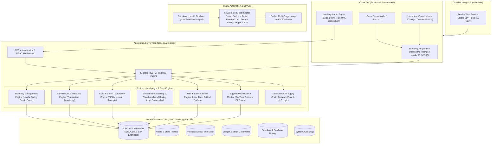

# Question 9: SupplyIQ Project Architecture Specification

## 1. Executive System Overview
**SupplyIQ** is an enterprise-grade, AI-powered Inventory and Supply Chain Intelligence Platform engineered to bridge the operational gap for retail grocery enterprises, FMCG distributors, and Kirana merchants. The platform processes high-velocity inventory ledgers, automates chronological transaction reordering to eliminate stock calculation anomalies, calculates dynamic replenishment thresholds, evaluates supplier performance metrics, and delivers predictive demand forecasts with contextual AI assistance via TradeSaarthi.

---

## 2. High-Level Architecture Diagram
The high-resolution visual representations of the system architecture are available in the following formats:
- **PNG (300 DPI High-Resolution Image):** [SupplyIQ_Architecture.png](file:///c:/Users/HP/Desktop/Akshu.S.P/SupplyIQ-AI-Powered-Inventory-Supply-Chain-Intelligence-Platform-main/Project_Submission_Evidence/01_Architecture/SupplyIQ_Architecture.png)
- **PDF (Vector Format for Print/Submission):** [SupplyIQ_Architecture.pdf](file:///c:/Users/HP/Desktop/Akshu.S.P/SupplyIQ-AI-Powered-Inventory-Supply-Chain-Intelligence-Platform-main/Project_Submission_Evidence/01_Architecture/SupplyIQ_Architecture.pdf)
- **SVG (Scalable Vector Graphics - Editable):** [SupplyIQ_Architecture.svg](file:///c:/Users/HP/Desktop/Akshu.S.P/SupplyIQ-AI-Powered-Inventory-Supply-Chain-Intelligence-Platform-main/Project_Submission_Evidence/01_Architecture/SupplyIQ_Architecture.svg)
- **Mermaid Source File:** [SupplyIQ_Architecture.mmd](file:///c:/Users/HP/Desktop/Akshu.S.P/SupplyIQ-AI-Powered-Inventory-Supply-Chain-Intelligence-Platform-main/Project_Submission_Evidence/01_Architecture/SupplyIQ_Architecture.mmd)

---

## 3. Detailed Component Breakdown

### 3.1 Client Tier (Presentation Layer)
- **Landing & Authentication (`landing.html`, `login.html`, `signup.html`):**
  - Modern, responsive landing page detailing product capabilities, problem statement, workflow stages, and live credentials.
  - User authentication interface with token management and auto-redirect logic.
- **SupplyIQ Grocery Dashboard (`SupplyIQ-Grocery-Dashboard.html`):**
  - Single-Page Application (SPA) architecture offering 8 core functional modules:
    1. *Dashboard Overview* (KPI ribbons, attention alert banners, hourly & daily sales charts).
    2. *Replenishment* (Automated Purchase Order recommendations, Reorder Points, and Safety Stock calculations).
    3. *Products Catalog* (Live search, category filters, shelf life tracking, margin analytics).
    4. *Inventory Levels* (Real-time stock balance, critical status tags, cover days).
    5. *Suppliers Management* (On-time in-full performance scores, lead times, contact profiles).
    6. *Risk & Alerts* (Stockout risk matrix, overstock indicators, expiry warnings).
    7. *Demand Forecasting* (Trend analysis, historical sales velocity, moving average projections).
    8. *Reports & Analytics* (Downloadable audits, ledger summaries, store performance reviews).
- **Guest Demo Mode (`?demo=1`):**
  - Designed specifically for immediate academic evaluation, investor demos, and frictionless walkthroughs without requiring user signup or OTP.
- **TradeSaarthi Interactive Assistant:**
  - Embedded conversational assistant answering natural language questions about running-out stock, fast-moving items, and purchasing suggestions.

### 3.2 Cloud Edge & Web Hosting Tier
- **Host Provider:** Render Cloud Application Platform (`supplyiq-9kmv.onrender.com`).
- **Static Assets & API Proxying:**
  - Node.js/Express statically serves `/public` assets, HTML5 dashboards, styles, and scripts.
  - Automatically terminates SSL/TLS and redirects HTTP to HTTPS.

### 3.3 Application Server Tier (Node.js & Express)
- **Server Core (`backend/server.js`):**
  - RESTful API framework handling all HTTP verbs and business operations.
  - Security hardening via Helmet, CORS origin restriction, and request rate limiting.
- **CSV Parsing & Validation Engine:**
  - Ingests single-file or multi-file CSV uploads (products, stock receipts, and sales).
  - Performs pre-validation: checks required columns, data types, barcode uniqueness, and chronological transaction sequence.
  - **Auto-Healing & Correction:** Detects negative stock balance errors when sales records precede stock receipts in a batch, dynamically reordering receipts before sales.
- **Inventory & Transaction Engine:**
  - Implements perpetual inventory tracking with FIFO cost flow.
  - Calculates Days of Inventory Cover: $\text{Cover Days} = \frac{\text{Current Stock}}{\text{Average Daily Sales}}$.
  - Computes Dynamic Safety Stock: $\text{Safety Stock} = Z \times \sqrt{L \times \sigma_d^2 + d^2 \times \sigma_L^2}$.
- **Demand Forecasting Engine:**
  - Evaluates trailing 7-day and 30-day moving averages.
  - Identifies consumption acceleration and flags imminent stockouts before lead-time thresholds expire.
- **Supplier Scoring Engine:**
  - Evaluates delivery timestamps against promised lead times to calculate On-Time In-Full (OTIF) percentages.

### 3.4 Data Persistence Tier
- **Production Database:** TiDB Cloud Serverless MySQL.
- **Security:** TLS 1.2+ certificate encryption (`DB_SSL: true`).
- **Relational Schema:**
  - `users`: User identity, credential hashes (bcrypt), and roles.
  - `store_profiles`: Multi-tenant store configurations and currency/tax settings.
  - `products`: SKU identifiers, descriptions, unit costs, selling prices, categories.
  - `inventory_batches`: Current stock levels, warehouse locations, expiration dates.
  - `stock_movements`: Immutable transaction ledger recording all receipts, issues, and adjustments.
  - `suppliers`: Vendor profiles, agreed lead times, contact details, and performance history.

### 3.5 CI/CD & DevOps Automation
- **GitHub Actions Pipeline (`.github/workflows/ci.yml`):**
  - Multi-stage pipeline executing 5 automated jobs on every push and pull request to `main`:
    1. `secret-scan`: Prevents accidental credential leaks.
    2. `backend-test`: Spins up a service container with MySQL 8.0, loads the database schema, and runs unit/integration suites.
    3. `frontend-validate`: HTML/CSS/JS syntax validation.
    4. `docker-build`: Builds production container image (`node:20-alpine`).
    5. `integration`: End-to-end verification of the multi-container stack via `docker-compose`.
